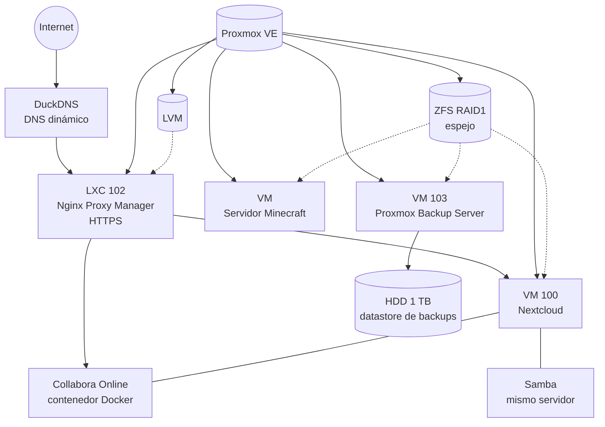

# Homelab Proxmox VE

Laboratorio de prácticas de administración de sistemas sobre **Proxmox VE**. Aquí documento cómo diseño, despliego, aseguro y automatizo una infraestructura propia: virtualización, servicios en la nube privada, copias de seguridad, monitorización y scripting.

---

## Índice

- [Objetivo](#objetivo)
- [Arquitectura](#arquitectura)
- [Servicios desplegados](#servicios-desplegados)
- [Automatización y scripts](#automatización-y-scripts)
- [Problemas resueltos](#problemas-resueltos)
- [Seguridad](#seguridad)
- [Hoja de ruta](#hoja-de-ruta)
- [Sobre mí](#sobre-mí)

---

## Objetivo

Practicar el trabajo real de un administrador de sistemas:

- Virtualizar servicios en **VMs y contenedores LXC**.
- Publicar servicios de forma segura mediante **proxy inverso y HTTPS**.
- Garantizar la recuperación ante fallos con **copias de seguridad**.
- Detectar problemas pronto con **scripts de monitorización y alertas**.
- **Documentar** cada decisión y cada error, para poder reproducirlo.

---

## Arquitectura

---

## Servicios desplegados

| ID | Tipo | Servicio | Función |
|----|------|----------|---------|
| 100 | VM | Nextcloud + Samba (Ubuntu Server) | Nube privada accesible desde internet y recursos compartidos en la red local |
| 102 | LXC | Nginx Proxy Manager | Proxy inverso, certificados SSL y dominios |
| 103 | VM | Proxmox Backup Server 4.2 (instalado desde ISO) | Copias de seguridad de máquinas virtuales y contenedores |
| — | VM | Servidor de Minecraft (Ubuntu Server) | Servidor de juego |
| — | Docker | Collabora Online (`collabora/code`) | Edición de documentos dentro de Nextcloud |

**Detalles técnicos a destacar**

- **Backups:** PBS con un disco HDD de 1 TB como almacenamiento dedicado.
- **Acceso externo:** dominios gestionados con DuckDNS y publicados a través de Nginx Proxy Manager.
- **Edición de documentos:** Collabora desplegado en un contenedor Docker independiente, con su propio dominio.

---

## Automatización y scripts

| Script | Qué hace | Herramientas |
|--------|----------|--------------|
| [`health-summary`](scripts/health-summary/) | Envía por correo un resumen periódico del servidor: temperatura de CPU, uso de CPU y RAM, disco, estado S.M.A.R.T. y actualizaciones pendientes | `msmtp`, `lm-sensors`, `sysstat`, `smartmontools` |
| [`nextcloud-healthcheck`](scripts/nextcloud-healthcheck/) | Comprueba la disponibilidad de Nextcloud y Collabora, avisa cuando cambia el estado y envía un resumen diario | Bash, `curl`, cron |
| [`ssh-failed-login-alert`](scripts/ssh-failed-login-alert/) | Alerta de intentos fallidos de acceso SSH con umbral configurable | `journalctl`, Bash |
| [`duckdns-update`](scripts/duckdns-update/) | Mantiene actualizada la IP pública en DuckDNS | Bash, cron |

---

## Problemas resueltos

**Collabora Online no arrancaba (servidor CODE integrado)**
- *Síntoma:* la edición de documentos en Nextcloud no funcionaba.
- *Diagnóstico:* el servidor CODE integrado no llegaba a iniciarse.
- *Solución:* desplegar `collabora/code` como contenedor Docker independiente, con su propio dominio, y configurarlo en Nextcloud.

**Error de proxy con Collabora en Nginx Proxy Manager**
- *Síntoma:* el proxy no conectaba con el backend.
- *Causa:* el contenedor sirve por TLS internamente, aunque se configure lo contrario.
- *Solución:* usar `https` como esquema del backend en NPM.

---

## Seguridad

- Contraseñas, tokens y claves **no** se incluyen en el repositorio (ver `.gitignore` y archivos `*.example`).
- Los dominios y direcciones IP de los ejemplos están sustituidos por valores ficticios.
- **SSH:** cada servidor tiene SSH con el puerto cambiado.
- **Firewall:** UFW configurado en cada servidor, con reglas básicas.
- **Fail2ban:** instalado en los servidores para bloquear intentos repetidos de acceso.
- **Alertas:** aviso de intentos fallidos de SSH mediante script.

---

## Hoja de ruta

- [x] Despliegue de Nextcloud, Samba y Nginx Proxy Manager
- [x] Copias de seguridad con Proxmox Backup Server
- [x] Scripts de monitorización y alertas por correo
- [x] UFW y fail2ban en los servidores
- [ ] Autenticación SSH solo con clave y sin acceso directo de root
- [ ] Revisar firewall y fail2ban en el propio host Proxmox
- [ ] Prueba de restauración de un backup, documentada paso a paso
- [ ] Monitorización con Zabbix o Grafana + Prometheus

---

## Sobre mí

Técnico en **Sistemas Microinformáticos y Redes (SMR)**, con el objetivo de trabajar como **administrador de sistemas** y próximamente cursando **ASIR**. Este laboratorio es mi forma de aprender haciendo y de documentar lo que aprendo.

- GitHub: [@Hugo33-bash](https://github.com/Hugo33-bash)
