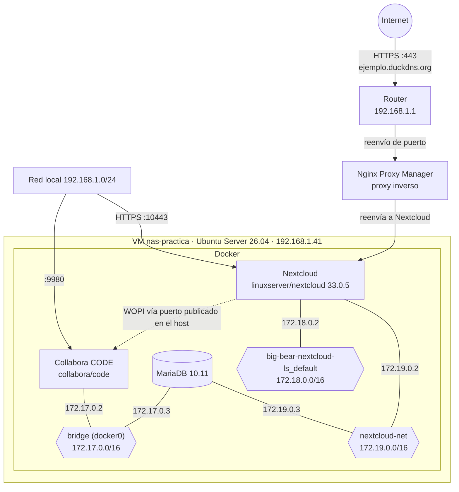

# Mi NAS: nas-practica

Tengo montado un NAS con Nextcloud, Collabora y MariaDB en Docker, dentro de una máquina virtual con Ubuntu Server en Proxmox.
En este documento explico cómo lo tengo organizado: qué servicios hay, en qué red está cada uno, dónde se guardan los datos y cómo se accede desde fuera de casa.

## Índice

1. [Máquina virtual](#máquina-virtual)
2. [Arquitectura](#arquitectura)
3. [Acceso desde internet](#acceso-desde-internet)
4. [Servicios](#servicios)
5. [Redes Docker](#redes-docker)
6. [Cómo se comunican los servicios](#cómo-se-comunican-los-servicios)
7. [Almacenamiento](#almacenamiento)
8. [Detalles del montaje](#detalles-del-montaje)
9. [Cosas que quiero mejorar](#cosas-que-quiero-mejorar)
10. [Comandos que usé](#comandos-que-usé)

## Máquina virtual

| Característica | Valor |
|---|---|
| Hostname | `nas-practica` |
| Virtualización | KVM/QEMU (Proxmox VE) |
| Sistema operativo | Ubuntu Server 26.04 LTS |
| CPU | 1 vCPU (la VM ve un Intel Core i7-3770) |
| RAM | 1,6 GiB + 2 GiB de swap |
| Disco | 45 GB con LVM (el volumen raíz es de 21,5 GB) |
| IP | 192.168.1.41/24 |
| Puerta de enlace | 192.168.1.1 |

---

## Arquitectura

Desde mi red local entro por dos puertos de la VM: el 10443 para Nextcloud y el 9980 para Collabora. Desde internet solo tengo abierto el 443, y las peticiones pasan por Nginx Proxy Manager antes de llegar a Nextcloud.

MariaDB no tiene ningún puerto publicado, solo se puede hablar con ella desde dentro de Docker. Nextcloud y MariaDB comparten la red `nextcloud-net`. Collabora está en otra red, así que no hablan directamente por Docker, sino a través del puerto 9980 de la VM.

---

## Acceso desde internet

Tengo Nextcloud accesible desde fuera de casa.

| Elemento | Valor |
| --- | --- |
| Puerto abierto a internet | `443` (HTTPS) |
| Dominio | ejemplo.duckdns.org (DuckDNS) |
| Proxy inverso | Nginx Proxy Manager (NPM) |
| Servicio publicado | Nextcloud |

Uso DuckDNS porque la IP pública de casa puede cambiar, y así siempre entro con el mismo nombre. El dominio que aparece aquí es de ejemplo, el real no lo publico.

Entre internet y Nextcloud hay un proxy inverso, Nginx Proxy Manager. Recibe las peticiones que llegan al 443 y las manda a Nextcloud, así que Nextcloud no está directamente expuesto. NPM no está en esta VM, corre aparte en un contenedor.

Al estar en internet, Nextcloud es lo más expuesto de todo el laboratorio. Lo que quiero revisar de esto está en [Cosas que quiero mejorar](#cosas-que-quiero-mejorar).

## Servicios

| Servicio | Imagen | Para qué lo uso | Puerto publicado | Redes |
|---|---|---|---|---|
| Nextcloud | `linuxserver/nextcloud:33.0.5` | Ficheros, calendario y contactos | `10443` → `443` (HTTPS) | `big-bear-nextcloud-ls_default`, `nextcloud-net` |
| Collabora Online | `collabora/code:latest` | Editar documentos desde el navegador | `9980` → `9980` | `bridge` |
| MariaDB | `mariadb:10.11` | Base de datos de Nextcloud | Ninguno (el `3306` es solo interno) | `bridge`, `nextcloud-net` |

El puerto 80 de Nextcloud no lo publico, solo se entra por HTTPS.

---

## Redes Docker

| Red | Driver | Subred | Contenedores (IP) |
|---|---|---|---|
| `bridge` (docker0) | bridge | 172.17.0.0/16 | Collabora (172.17.0.2), MariaDB (172.17.0.3) |
| `big-bear-nextcloud-ls_default` | bridge | 172.18.0.0/16 | Nextcloud (172.18.0.2) |
| `nextcloud-net` | bridge | 172.19.0.0/16 | Nextcloud (172.19.0.2), MariaDB (172.19.0.3) |
| `host` | host | - | Ninguno |
| `none` | null | - | Ninguno |

Una red de Docker funciona como un switch virtual, y cada contenedor tiene una tarjeta de red por cada red a la que está conectado. Dos contenedores solo se ven directamente si comparten red.

| Contenedor | `bridge` | `big-bear-nextcloud-ls_default` | `nextcloud-net` |
|---|---|---|---|
| Nextcloud | - | 172.18.0.2 | 172.19.0.2 |
| Collabora | 172.17.0.2 | - | - |
| MariaDB | 172.17.0.3 | - | 172.19.0.3 |

---

## Cómo se comunican los servicios

1. Desde casa entro a Nextcloud por HTTPS al puerto 10443 de la VM. Desde internet entro por el dominio, pasando por NPM.
2. Nextcloud habla con MariaDB por `nextcloud-net`. Como no es la red `bridge` por defecto, Docker resuelve el nombre del contenedor (`mariadb-nextcloud`) sin necesidad de usar IPs.
3. Nextcloud y Collabora no comparten red, así que se comunican por el puerto 9980 publicado en la VM. El navegador también se conecta directamente a Collabora para cargar el editor.

---

## Almacenamiento

| Servicio | Origen (en la VM) | Destino (en el contenedor) | Tipo |
|---|---|---|---|
| MariaDB | `/var/lib/docker/volumes/mariadb_data/_data` | `/var/lib/mysql` | Volumen de Docker |
| Nextcloud | `/DATA/AppData/big-bear-nextcloud-ls/config` | `/config` | Bind mount |
| Nextcloud | `/DATA/AppData/big-bear-nextcloud-ls/data` | `/data` | Bind mount |
| Collabora | - | - | No guarda nada |

Collabora no guarda estado, así que si borro el contenedor no pierdo nada: los documentos están en Nextcloud. Todo está en el mismo disco que el sistema (la raíz, de 21,5 GB).

## Detalles del montaje

- MariaDB no tiene el puerto 3306 publicado, así que desde la red local no se puede conectar nadie. Nextcloud llega por `nextcloud-net`. Collabora también podría llegar, lo explico en las mejoras.
- Nextcloud y MariaDB tienen su propia red, `nextcloud-net`, donde Docker resuelve los nombres de los contenedores. En la red `bridge` por defecto eso no funciona.
- Nextcloud (`33.0.5`) y MariaDB (`10.11`) tienen una versión concreta. Collabora está en `latest`.
- La configuración y los datos de Nextcloud están en `/DATA/AppData`, y la base de datos en un volumen de Docker. Así puedo recrear los contenedores sin perder información.
- Nextcloud no está publicado directamente en internet: el tráfico externo pasa antes por Nginx Proxy Manager.

---

## Cosas que quiero mejorar

| Mejora | Por qué |
|---|---|
| Quitar MariaDB de la red `bridge` | Solo necesita `nextcloud-net`. Estando también en `bridge`, Collabora puede llegar a su puerto 3306. |
| Fijar la versión de Collabora | Con `latest` puede cambiar de versión al recrear el contenedor y romper la integración con Nextcloud. |
| Ampliar el volumen lógico | Hay unos 20 GB sin asignar en el grupo LVM y la raíz está al 71 %. |
| Darle más RAM a la VM | Tiene 1,6 GiB y ya usa swap, así que hay poco margen para más servicios (por ejemplo, monitorización). |
| Hacer copias de seguridad | Datos y sistema están en el mismo disco y no hay backup automático. Una opción es usar Proxmox Backup Server. |
| Comprobar que solo está abierto el 443 | El 9980 y el 10443 no deberían estar abiertos a internet. |
| Proteger mejor el acceso desde internet | Mantener Nextcloud actualizado, activar el doble factor (2FA) y revisar los accesos fallidos. |
