# Montaje e instalación de Proxmox Backup Server

*Guía resumida paso a paso*

Preparar un servidor PBS y conectarlo con Proxmox VE para disponer de un destino centralizado donde almacenar copias de seguridad.

## 0. Requisitos

Para montar un Servidor de Backups necesitamos un disco duro donde volcar las backups, yo en mi caso usaré un disco de 1TB HDD.

## 1. Introducción

En esta guía se explica cómo montar un servidor Proxmox Backup Server (PBS) dentro de un entorno Proxmox VE. La idea es preparar una máquina virtual, instalar PBS, configurar un disco para guardar las copias de seguridad y, por último, conectar ese servidor con Proxmox VE para poder utilizarlo como almacenamiento de backups.

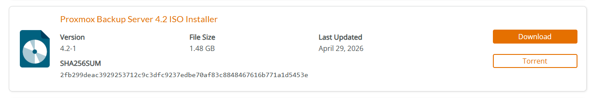

## 2. Descargar y cargar la ISO

El primer paso es descargar la imagen ISO de Proxmox Backup Server desde la página oficial de descargas de Proxmox: *https://www.proxmox.com/en/downloads*. Una vez descargada, entramos en la interfaz web de Proxmox VE y vamos al almacenamiento local del nodo (local/pve) > Imágenes ISO > Cargar. Seleccionamos la ISO de PBS y esperamos a que termine la subida.

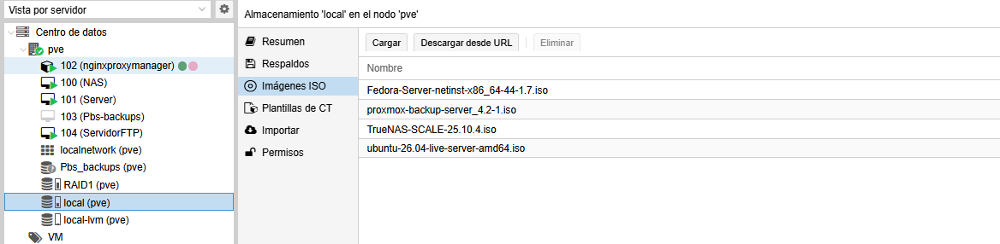

## 3. Crear la máquina virtual

Con la ISO ya disponible, creamos una máquina virtual desde «Crear VM». En el ejemplo de las capturas se utiliza el nombre «Pbs-backups», el ID 105, 2 núcleos de CPU, 2048 MB de memoria y un disco virtual de 32 GB sobre el almacenamiento RAID1. En la pestaña de sistema se selecciona la ISO de Proxmox Backup Server como media de instalación. Estos valores son los del ejemplo y se pueden adaptar a los recursos del equipo.

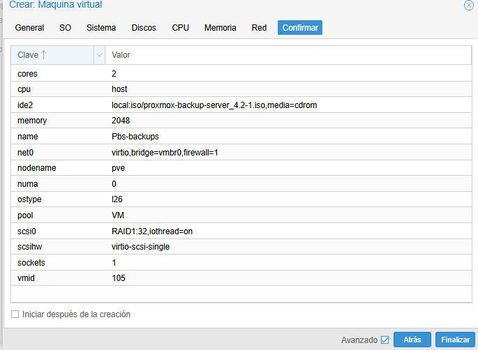

## 4. Instalar Proxmox Backup Server

Arrancamos la máquina virtual y seguimos el asistente de instalación.
Primero aceptamos el acuerdo de licencia y continuamos.

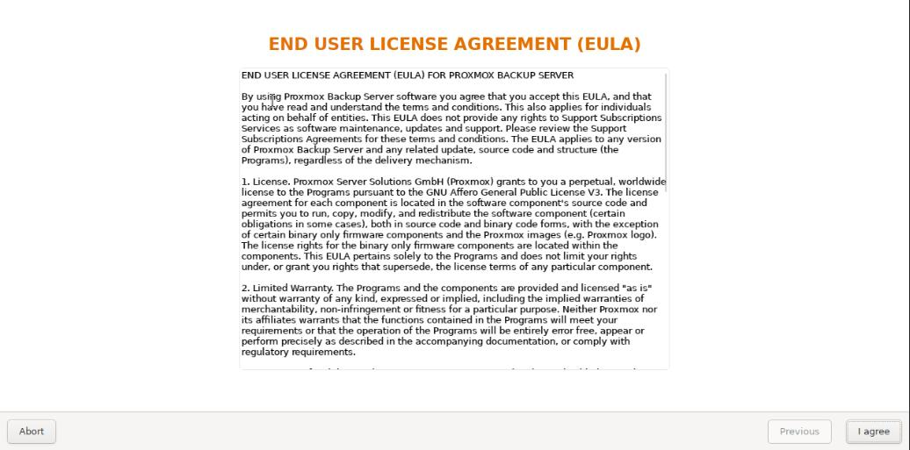

Después revisamos el disco de destino donde se instalará PBS. Hay que comprobarlo con cuidado, porque el instalador indica que los datos del disco seleccionado se eliminarán.

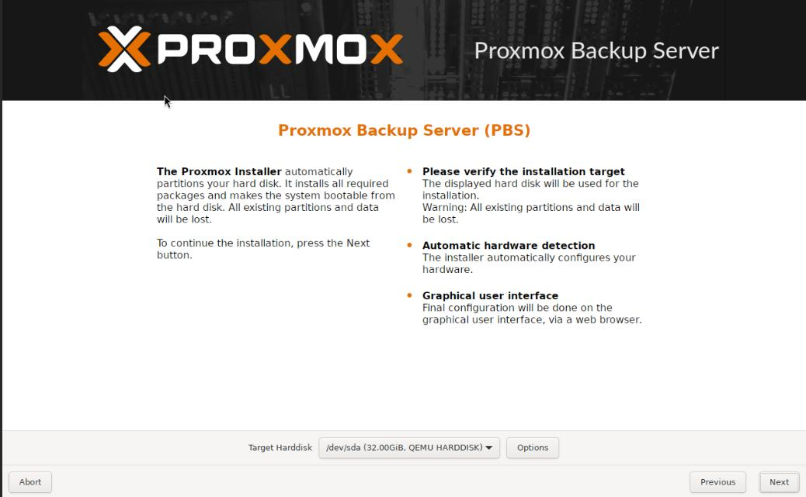

## 5. Configurar la red

Durante la instalación configuramos los datos de red que permitirán acceder al servidor desde el navegador, siendo estos la IP local + la máscara en formato CIDR y la puerta de enlace.

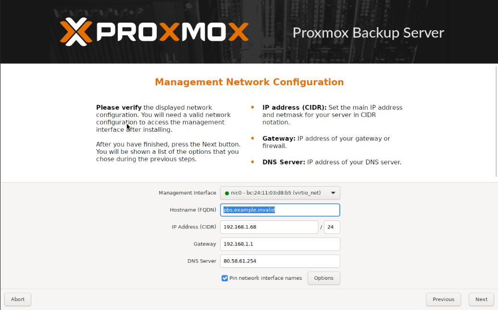

## 6. Crear el almacenamiento de copias 

Una vez dentro de la interfaz web del PBS, entramos en «Administration» > «Storage / Disks» y comprobamos los discos disponibles.

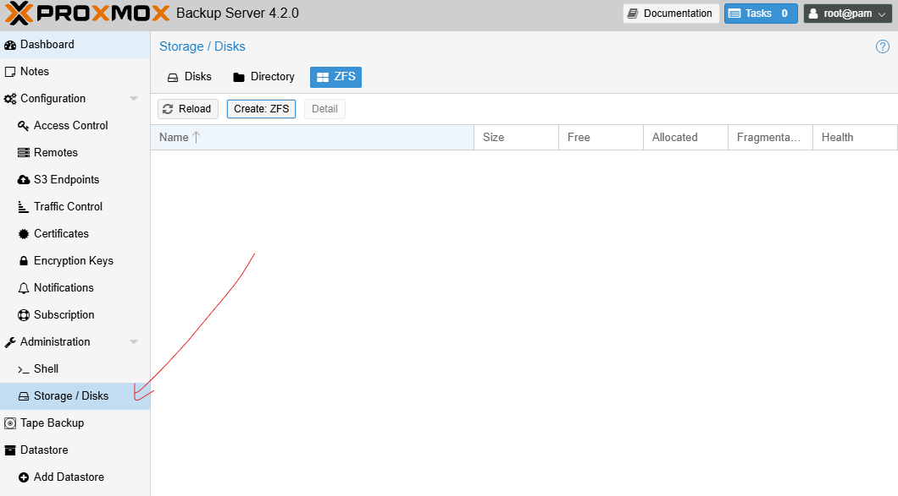

En el ejemplo se utiliza el disco /dev/sdb, de 1TB, para crear un almacenamiento ZFS. Pulsamos «Create: ZFS» e indicamos un nombre, en este caso Pbs-backups1.

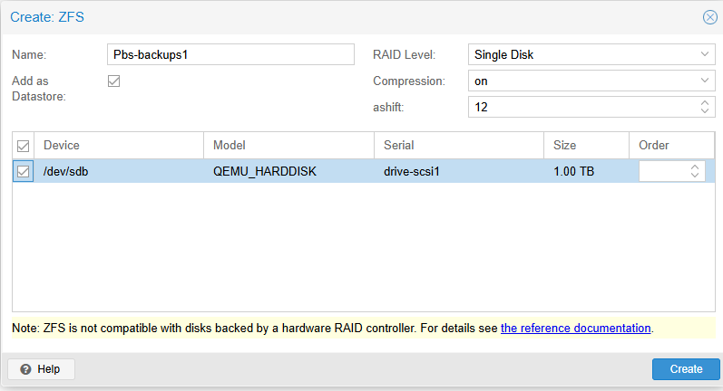
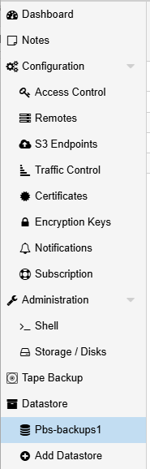

## 7. Comprobar el Datastore

Después de crearlo, el nuevo almacenamiento aparece en el apartado «Datastore» en el menú lateral de PBS.

## 8. Añadir PBS a Proxmox VE 

Para que Proxmox pueda enviar copias de seguridad al servidor PBS volvemos a la interfaz de Proxmox VE y entramos en Datacenter > Almacenamiento > Agregar Proxmox Backup Server.

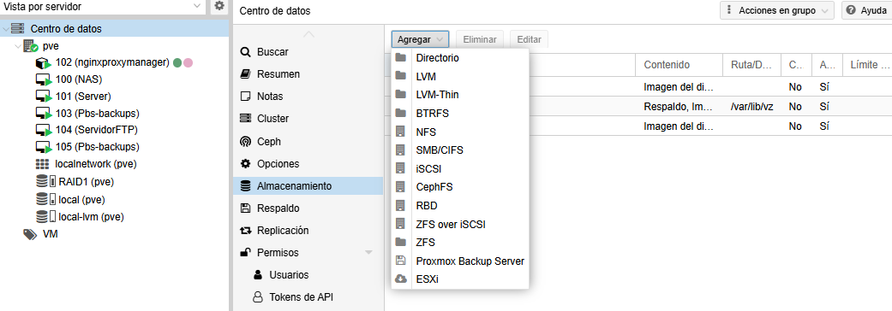

Luego de eso rellenamos los campos: ID para identificar el almacenamiento, dirección IP del servidor PBS, usuario con @pam y contraseña del servidor, y el mismo nombre de datastore que le pusimos dentro del servidor PBS.

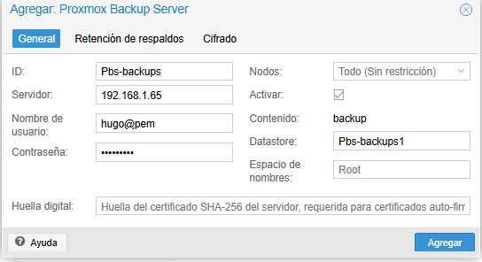

## 9. Programación de Backups

### 9.1 Explicación 

En este tutorial explicaremos cómo hacer algo tan sencillo como una programación de backups en Proxmox Backup Server.

### 9.2 Configuración

Nos vamos a nivel de Datacenter > Respaldo y le damos a Agregar:

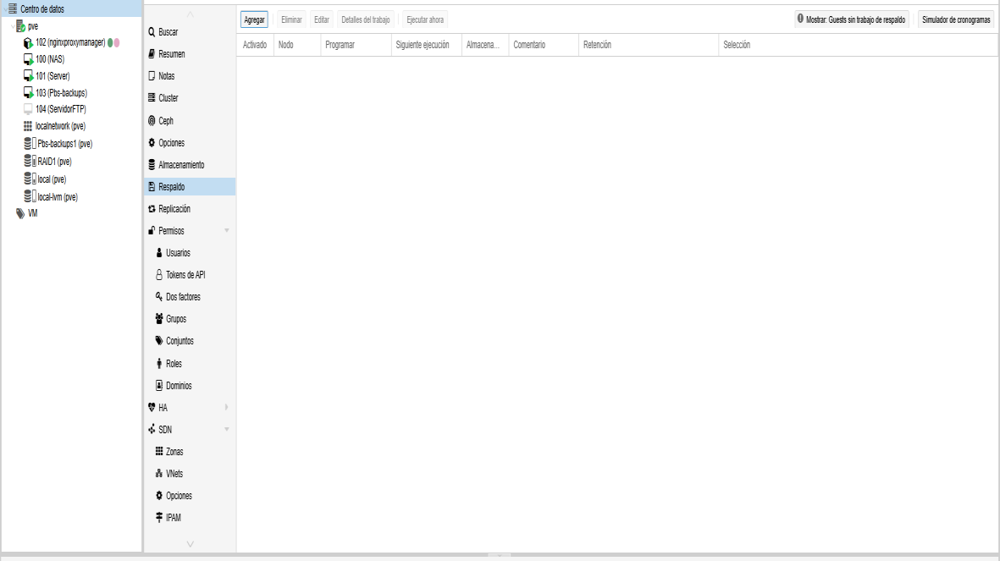

Una vez le demos a Agregar, veremos el nodo, el almacenamiento que estamos usando y una de las cosas más importantes, que es cuándo vamos a hacer la programación:

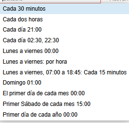

En mi caso lo pondré de lunes a viernes, por hora. Luego nos saldrá de qué máquinas virtuales queremos que se haga el backup; yo incluiré el servidor NAS, que tengo como nube privada, en el cual subo documentos diariamente. Una vez incluidas las máquinas virtuales de las que queremos que se haga backup, le damos a crear programación.

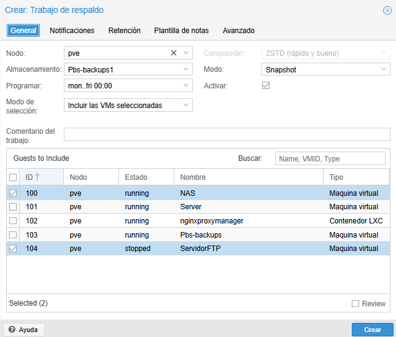
