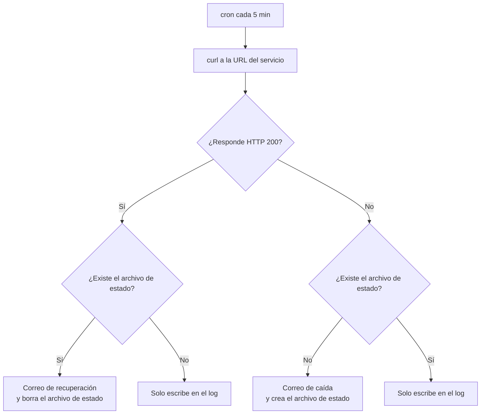

# nextcloud-healhcheck

Script en bash que vigila **Nextcloud** y **Collabora Online** y envia un correo cuando alguno deja de responder.

## ¿Qué problema resuelve?

Si Nextcloud o Collabora sea caen, no me entero hasta que intento usarlo. Este escript comprueba cada 5 minutos y el me avisa.

- **Avisa una sola vez** Cuado es servicio se cae.
- **Avisa una sola vez** Cuando el servicio se levanta.
- Con un **resumen diario** que confirma que la vigilancia sigua funcionado. Si un dia no llega ese correo, es la señal de que falla el propio sistema de avisos.

## Como funciona 


### El archivo de estado: por qué existe

Si él, un servicio caida durante una hora enviaría **12 Correo ¡** (uno cada 5 minutos). El script usa un archivo vacío como memoria:


| Resultado ahora | ¿Existe el archivo de estado? | Acción |
|-----------------|-------------------------------|--------|
| 200 | No | Solo registra en el log |
| 200 | Sí | Correo de **recuperación** y borra el archivo |
| Distinto de 200 | No | Correo de **caída** y crea el archivo |
| Distinto de 200 | Sí | Solo registra en el log (no repite el aviso) |

Cada servicio tiene su propio archivo, así que Nextcloud y Collabora se vigilan de forma independiente.

## Requisitos 

- Linux con `bash` y `curl`.
- Un comando de `mail` que funcione (ver [Configuración del correo](#configuración-del-correo)).
- Permisos para escribir en el archivo de log (por defecto en `var/log`).

## Configuración

| Variable | Qué es |
|----------|--------|
| `NEXTCLOUD_URL` | Dirección que se comprueba de Nextcloud. Uso `/status.php`, una página ligera que devuelve un JSON con el estado y no requiere iniciar sesión. |
| `COLLABORA_URL` | Dirección que se comprueba de Collabora. Uso `/hosting/discovery`, la misma que consulta Nextcloud para saber qué ofrece Collabora. Si responde, el servicio está activo. |
| `EMAIL_TO` / `EMAIL_FROM` | Destinatario y remitente de los avisos. |
| `LOGFILE` | Archivo donde se registra cada comprobación. |
| `STATE_NEXTCLOUD` / `STATE_COLLABORA` | Archivos de estado (ver arriba). |
| `LAST_SUMMARY_FILE` | Guarda la fecha del último resumen diario para enviarlo solo una vez al día. |

## Explicacion por bloques

### La comprobación


```bash
HTTP_CODE=$(curl -s -o /dev/null -w "%{http_code}" --max-time 10 "${url}")
```
| Opción | Para qué sirve |
|--------|----------------|
| `-s` | Modo silencioso: sin barra de progreso. |
| `-o /dev/null` | Descarta el contenido de la página, porque solo me importa el código. |
| `-w "%{http_code}"` | Imprime únicamente el código HTTP. |
| `--max-time 10` | Si no hay respuesta en 10 segundos, `curl` se rinde y el script no se queda colgado. |

Códigos que puedo encontrar:

- '200': todo bien.
- '000': no hubo respuesta (servidor caido, DNS roto o tiempo de espera agotado).
- '502' / '503': el proxy responde pero el servidor de detras no.
- '404': La dirección no existe, por ejemplo si cambia la ruta.

Cualquier cosa distinta de '200' se trata cini fallo.

### Por qué se comprueba por la dirección pública
 
El script llama a la URL con el dominio de DuckDNS, no a la IP interna. Así verifica **toda la cadena**: DNS, router, Nginx Proxy Manager, certificado HTTPS y el servicio. Un fallo en cualquiera de esas piezas se detecta.
 
### Valor de retorno con `$(...)`
 
`check_service` imprime `OK` o `FALLO (HTTP ...)`, y el script lo captura en `RESULT_NEXTCLOUD` y `RESULT_COLLABORA`. Esos textos se usan después en el resumen diario. El log y los correos no interfieren, porque escriben en un archivo y en `mail`, no en la salida estándar.
 
### El resumen diario
 
La primera ejecución de cada día compara la fecha de hoy con la guardada en `LAST_SUMMARY_FILE`. Si son distintas, envía el correo y guarda la fecha. Funciona como un "latido": confirma que el script y el correo siguen vivos.
 
## Configuración del correo
 
El script usa el comando `mail`, que necesita un relé SMTP. Este es un ejemplo con `msmtp` y Gmail. Adáptalo a tu proveedor.

```bash
sudo apt install msmtp msmtp-mta bsd-mailx
sudo nano /etc/msmtprc
```
 
```
defaults
auth           on
tls            on
tls_trust_file /etc/ssl/certs/ca-certificates.crt
 
account        gmail
host           smtp.gmail.com
port           587
tls_starttls   on
from           tu-correo@gmail.com
user           tu-correo@gmail.com
password       TU_CONTRASEÑA_DE_APLICACION
 
account default : gmail
```
 
```bash
sudo chmod 600 /etc/msmtprc
```
 
Notas importantes:
 
- Gmail no admite la contraseña normal: hay que crear una **contraseña de aplicación** (requiere tener la verificación en dos pasos activada).
- `chmod 600` es obligatorio, porque el archivo contiene una contraseña.
- Esa contraseña **nunca** va al repositorio ni al script.
Prueba que el correo funciona antes de usar el script:
 
```bash
echo "Prueba" | mail -s "Prueba de correo" tu-correo@gmail.com
```
 
## Instalación
 
```bash
sudo cp nextcloud-healthcheck.sh /usr/local/bin/
sudo nano /usr/local/bin/nextcloud-healthcheck.sh   # poner tus URLs y correos
sudo chmod 700 /usr/local/bin/nextcloud-healthcheck.sh
```
 
## Cómo probarlo
 
1. **Ejecución normal:**
```bash
   sudo /usr/local/bin/nextcloud-healthcheck.sh
   tail -n 3 /var/log/healthcheck-nextcloud.log
```
   Debe aparecer `Nextcloud OK (HTTP 200)` y `Collabora OK (HTTP 200)`. La primera ejecución del día envía además el resumen diario.
 
2. **Provocar un fallo:** cambia `COLLABORA_URL` por una ruta que no exista (por ejemplo `/hosting/discovery-x`) y ejecuta el script. Debe llegar un correo de caída y crearse `/tmp/.collabora_down`. Si lo ejecutas otra vez, **no** debe llegar un segundo correo.
3. **Probar la recuperación:** devuelve la URL correcta y ejecuta de nuevo. Debe llegar el correo de recuperación y borrarse el archivo de estado.
4. **Repetir el resumen diario:** borra el archivo con `sudo rm /tmp/.healthcheck_last_summary` y vuelve a ejecutar.
## Automatizarlo con cron
 
```bash
sudo crontab -e
```
```
*/5 * * * * /usr/local/bin/nextcloud-healthcheck.sh >/dev/null 2>&1
```
 
Cada 5 minutos permite detectar una caída pronto sin generar tráfico innecesario. Se ejecuta con el cron de root porque escribe en `/var/log`.
 
## Limitaciones conocidas
 
- **Dónde se ejecuta importa.** Si corre en la misma máquina que Nextcloud, o en la misma conexión de internet, una caída total puede impedir que el aviso salga. Lo ideal es ejecutarlo desde otra máquina.
- **Los archivos de estado están en `/tmp`.** Se vacían al reiniciar, así que después de un reinicio se puede repetir un aviso. Además, `/tmp` es una carpeta accesible a todos los usuarios del sistema.
- **El log crece sin límite.** Son unas 576 líneas al día. Es poco, pero conviene configurar `logrotate`.
- **Solo comprueba el código HTTP.** `status.php` devuelve un JSON con el estado de Nextcloud (incluido el modo mantenimiento), pero el script no lo lee, así que no distingue un Nextcloud sano de uno en mantenimiento.
- **Si el correo falla, el aviso se pierde en silencio.** El resumen diario ayuda: su ausencia delata el problema.
## Posibles mejoras
 
- Mover los archivos de estado a `/var/lib/` con permisos restringidos.
- Leer el contenido de `status.php` y comprobar que `maintenance` es `false`.
- Rotar el log con `logrotate`.
- Añadir un segundo canal de aviso (Telegram o ntfy) por si el correo falla.
- Avisar si el certificado HTTPS está a punto de caducar.
